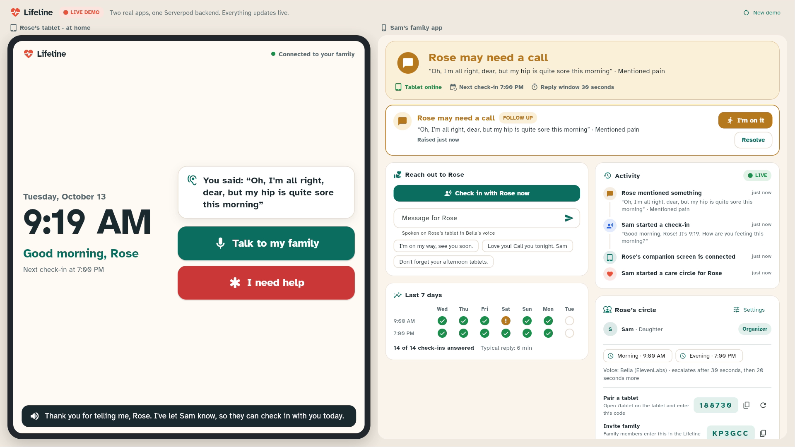
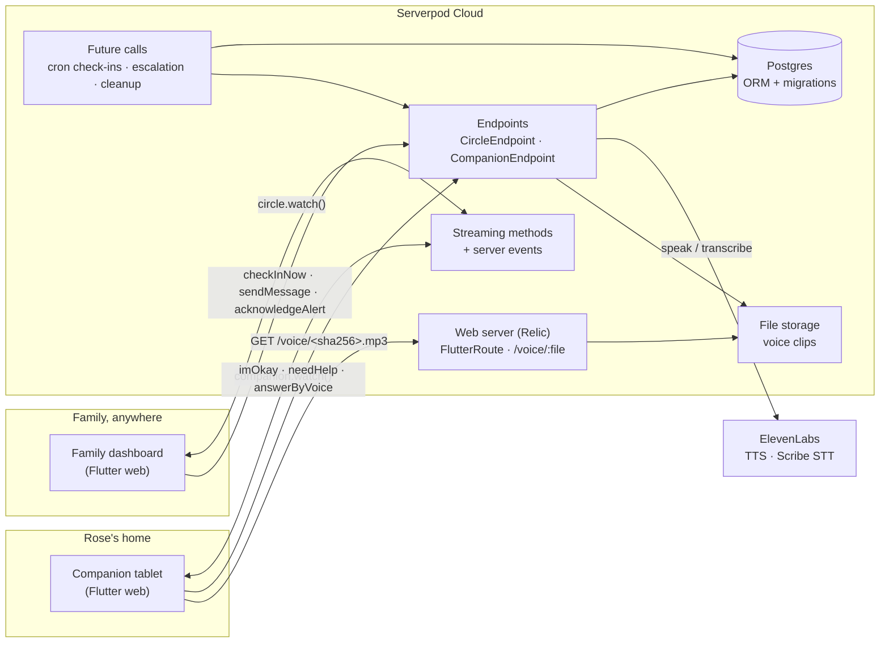
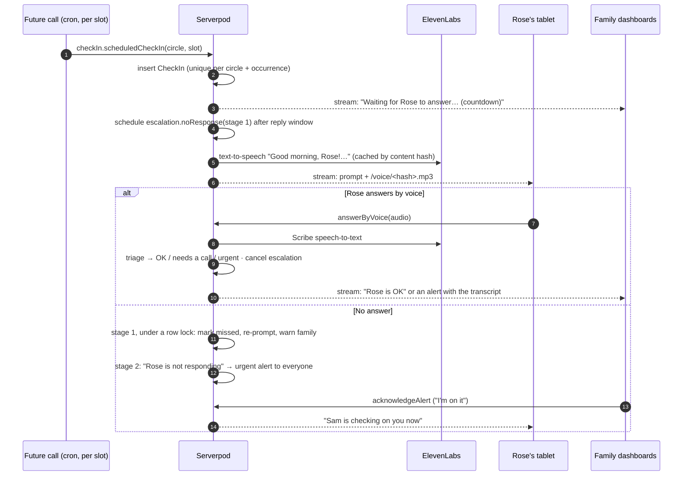

<p align="center">
  
</p>

<h1 align="center">Lifeline</h1>

<p align="center">
  <b>A daily voice check-in for loved ones who live alone, and an instant alert to their family when something is wrong.</b>
</p>

<p align="center">
  <a href="docs/media/lifeline-demo.mp4"><b>▶ Watch the 2-minute demo</b></a> ·
  <a href="https://lifeline.serverpod.space/demo"><b>Try the live demo</b></a> (no sign-up) ·
  <a href="https://lifeline.serverpod.space">lifeline.serverpod.space</a>
</p>



## 1. What is Lifeline?

Lifeline turns any tablet into a voice-first safety net for an older adult who lives alone. At the times the family chooses, it greets them by name in a warm, natural ElevenLabs voice and asks how they are; one big button, or a few spoken words, tells the family all is well. Spoken answers are transcribed and checked for worrying words like *fallen*, *dizzy* or *pain*, and if nobody answers, Serverpod future calls ask again and then escalate to the whole family. Family members watch a live dashboard, tap **"I'm on it"** so everyone (including the loved one) knows help is coming, and send messages that are read aloud on the tablet.

## 2. The problem, and our solution

### The problem: when someone who lives alone falls, nobody may notice for hours

- **16.2 million** older Americans live alone ([ACL, 2023 Profile of Older Americans](https://acl.gov/sites/default/files/Profile%20of%20OA/ACL_ProfileOlderAmericans2023_508.pdf)).
- **1 in 4** adults aged 65+ report a fall each year: 14 million people in 2020 ([CDC](https://stacks.cdc.gov/view/cdc/122749)).
- Of people over 90 who fell, **80% could not get up on their own** and **30% lay on the floor for an hour or more** ([Fleming & Brayne, BMJ 2008](https://www.bmj.com/content/337/bmj.a2227)). This "long lie" is what turns a fall into dehydration, pressure injuries, pneumonia and a hospital stay.

Today's options all depend on the wrong person acting at the wrong moment:

| | Who has to act when something is wrong? | Weak spot |
|---|---|---|
| Pendant alarm | The person who fell: must be wearing it, conscious, and willing to press it | Often taken off, forgotten, or not pressed |
| Daily phone call | One relative who must remember, every day | Missed calls cause panic; nobody else knows; doesn't scale |
| Cameras | A relative watching a feed | Invasive, and still needs someone watching |
| **Lifeline** | **Nobody: silence itself is the signal** | |

### Our solution

1. **Silence is the signal.** Every check-in is a promise to come back: if there is no answer within the reply window, a Serverpod future call fires, Lifeline asks again out loud, warns the family, and then raises an urgent alert to everyone. Nobody has to press anything for help to be called.
2. **Voice-first, zero learning curve.** The loved one never logs in or types. The tablet speaks in a natural ElevenLabs voice, shows every spoken line as large captions, and offers three huge buttons: **I'm okay**, **Tell me**, **I need help**. Text uses Atkinson Hyperlegible, a typeface designed by the Braille Institute for low vision.
3. **Hears what a button can't.** "I'm fine, but my hip is quite sore" is transcribed by ElevenLabs Scribe and triaged by transparent, testable rules (fall, can't get up, chest pain, dizziness, low mood, missed medication...) into *OK*, *needs a call* or *urgent*, with the reasons shown to the family. No black box deciding whether Grandma needs help.
4. **The whole family, coordinated.** Everyone in the care circle sees the same live status, countdown and history. **"I'm on it"** stops five relatives from panicking in parallel, and the tablet tells the loved one, in plain words, that someone is coming.
5. **Warmth, not surveillance.** Family members can type a message ("I'm on my way, see you soon") that is spoken on the tablet, so the device that checks on them also connects them.

## 3. How we use Serverpod

Lifeline is one **Serverpod 4** backend and one Flutter app with two faces (the loved one's tablet and the family dashboard), deployed on **Serverpod Cloud**. Serverpod isn't a thin API layer here: scheduling, real-time push, storage, auth and the web server are all load-bearing.



### A check-in, end to end



### Serverpod features, and where to find them

| Serverpod feature | How Lifeline uses it | Code |
|---|---|---|
| **Endpoints + generated client** | `CircleEndpoint` for family (`requireLogin`, membership checks) and `CompanionEndpoint` for tablets (hashed device tokens). The Flutter app calls them as typed Dart methods. | [`circle_endpoint.dart`](lifeline_server/lib/src/circles/circle_endpoint.dart), [`companion_endpoint.dart`](lifeline_server/lib/src/companion/companion_endpoint.dart) |
| **Streaming methods** | `circle.watch()` and `companion.watch()` push complete snapshots over Serverpod's managed WebSocket; the client reconnects with backoff. | [`snapshots.dart`](lifeline_server/lib/src/circles/snapshots.dart), [`live_stream.dart`](lifeline_flutter/lib/state/live_stream.dart) |
| **Server events** | Every state change posts a `CircleSignal` to the circle's channel; streams debounce bursts and add a heartbeat for time-based state. | [`circle_channel.dart`](lifeline_server/lib/src/realtime/circle_channel.dart) |
| **Future calls: recurring** | Each daily check-in time is its own `callRecurring().cron(...)` future call, converted from the loved one's local time to UTC, rescheduled when settings change. | [`schedules.dart`](lifeline_server/lib/src/checkins/schedules.dart) |
| **Future calls: delayed + cancellable** | Two-stage escalation with `callWithDelay(identifier:)`, cancelled by identifier the moment Rose answers. A third future call deletes demo circles after 12 hours. | [`check_in_service.dart`](lifeline_server/lib/src/checkins/check_in_service.dart), [`check_in_future_calls.dart`](lifeline_server/lib/src/checkins/check_in_future_calls.dart) |
| **At-least-once safety** | Future calls may run twice, so check-ins have a unique `(circleId, scheduledFor)` index, and answering/escalating happen in transactions with `LockMode.forUpdate` row locks. | [`check_in.spy.yaml`](lifeline_server/lib/src/models/tables/check_in.spy.yaml) |
| **Models, ORM, migrations** | 9 tables with relations and cascade deletes, enums, unique and composite indexes, `serverOnly` fields for secrets (token hashes, user ids), typed `LifelineException`. | [`models/`](lifeline_server/lib/src/models), [`migrations/`](lifeline_server/migrations) |
| **Authentication** (`serverpod_auth_idp`) | Email sign-in (verification codes sent by Serverpod Cloud) plus anonymous "continue without account", JWT tokens with refresh. | [`server.dart`](lifeline_server/lib/server.dart), [`family_home.dart`](lifeline_flutter/lib/screens/family/family_home.dart) |
| **File storage** | Every ElevenLabs clip is stored once in `public` storage, content-addressed by SHA-256 of model + voice + text, and indexed in a `VoiceClip` table. | [`voice_service.dart`](lifeline_server/lib/src/voice/voice_service.dart) |
| **Web server (Relic)** | `FlutterRoute` serves the app with SPA fallback; a custom `VoiceRoute` serves `/voice/<sha256>.mp3` with `immutable` cache headers so the Serverpod Cloud CDN caches clips at the edge. | [`voice_route.dart`](lifeline_server/lib/src/voice/voice_route.dart) |
| **Caching** | `session.caches.local` keeps hot clips in memory. | [`voice_service.dart`](lifeline_server/lib/src/voice/voice_service.dart) |
| **Passwords** | The ElevenLabs key is a Serverpod Cloud password, read with `session.passwords['elevenLabsApiKey']`; it never reaches the app. | [`voice_service.dart`](lifeline_server/lib/src/voice/voice_service.dart) |
| **Test tools** | `withServerpod` integration tests against a real database, including invoking future calls directly (`endpoints.futureCalls.escalation.noResponse`) to test escalation and idempotency. | [`check_in_flow_test.dart`](lifeline_server/test/integration/check_in_flow_test.dart) |
| **Serverpod Cloud** | Managed Postgres, file storage, CDN, encrypted passwords, and pre-deploy hooks that run `serverpod generate` and build the Flutter web app on every deploy. | [`scloud.yaml`](lifeline_server/scloud.yaml) |

## Try it

- **Live demo (recommended):** <https://lifeline.serverpod.space/demo>. One click creates a private sandbox with Rose's tablet and Sam's dashboard side by side. Escalation timers are shortened to 20 seconds so you can watch a missed check-in escalate. Turn your sound on, and allow the microphone if you want to answer by voice.
- **Real setup:** open <https://lifeline.serverpod.space/family>, sign in, and create a care circle; then open <https://lifeline.serverpod.space/tablet> on the tablet and enter the 6-digit pairing code. Invite more family with the invite code.

## Run it locally

Requirements: Flutter 3.44+ (Dart 3.12+) and the Serverpod CLI 4 (`dart install serverpod_cli`). No Docker needed: Serverpod starts an embedded PostgreSQL.

```bash
git clone https://github.com/chinesepowered/hack-sp-lifeline.git
cd hack-sp-lifeline/lifeline_server

# Optional: real voices. Without a key, the app falls back to the browser's speech.
export SERVERPOD_PASSWORD_elevenLabsApiKey=<your ElevenLabs API key>

serverpod start          # server + database + Flutter app, with hot reload
```

Then open <http://localhost:8082/demo> (after `serverpod run flutter_build`) or the Flutter app that `serverpod start` launches.

Run the tests (unit + integration against a real database):

```bash
cd lifeline_server && dart test
```

## Project structure

```text
lifeline_server/     Serverpod backend
  lib/src/models/      .spy.yaml models: tables, enums, DTOs, exception
  lib/src/circles/     CircleEndpoint, circle service, snapshots, access control
  lib/src/companion/   CompanionEndpoint (the tablet)
  lib/src/checkins/    check-in service, schedules, future calls, spoken phrases
  lib/src/voice/       ElevenLabs client, voice cache, /voice web route
  lib/src/triage/      rule-based triage of spoken answers
  lib/src/realtime/    server-event channel for live updates
  test/                unit and integration tests
lifeline_client/     generated client
lifeline_flutter/    Flutter app: landing, /demo, /family, /tablet
```

## Built with AI assistance

Following the hackathon rules on disclosure: this project was designed and built with **Claude Code** (Anthropic) as an AI pair programmer, including code, tests, the README and the demo video edit. The demo's narration, the companion's voice and "Rose's" voice were generated with ElevenLabs.
